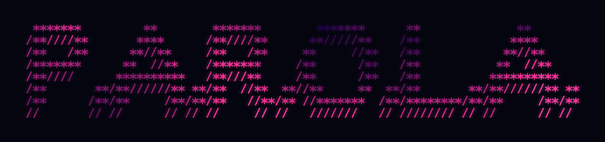

<h1 align="center"></h1>
<p align="center"><b>P</b>arlato <b>A</b>scoltato, <b>R</b>iconosciuto e <b>O</b>rganizzato in <b>L</b>ocale, <b>A</b>lla lettera</p>

Verbatim transcription of audio and calls, **100% local** on Apple Silicon Macs, for Italian and
English (including both mixed in the same sentence).

"Verbatim" means hesitations, repetitions, truncated words and false starts are kept. A clean
layer will be derived from the verbatim one, never the other way around.

The command is `parola`. The old name `ilat` still works for now and prints a notice.

How it is measured, which models it uses and why: [`METHODOLOGY.md`](METHODOLOGY.md).

Status: early development (Phase 1, see [`docs/PLAN.md`](docs/PLAN.md)).

## Requirements

- macOS on Apple Silicon
- [uv](https://docs.astral.sh/uv/) and [ffmpeg](https://ffmpeg.org/): `brew install uv ffmpeg`

## Setup

```bash
uv sync
uv run pre-commit install
```

The first transcription downloads `mlx-community/whisper-large-v3-turbo` (~1.6 GB) from
Hugging Face into the local cache. After that, nothing goes over the network.

## Usage

```bash
uv run parola transcribe path/to/call.m4a            # language auto-detected
uv run parola transcribe path/to/call.mp4 --lang it  # force Italian
uv run parola transcribe call.m4a --out transcripts/
```

Writes `<name>.json` (segments and words with timestamps) and `<name>.txt` (readable, one line
per segment) next to the input, or into `--out`.

### Recording a call

```bash
uv run parola record                       # Ctrl-C to stop; files in data/private/calls/
```

Records your microphone ("Io") and the system audio ("Altri") with Core Audio taps (macOS 14.2+,
no virtual driver), transcribes each side with Whisper turbo and marks the words a second
transcription (Parakeet v3) does not confirm as `(doubtful?)` in the text. The first run asks for
the microphone and system-audio recording permissions. Once the models are downloaded, nothing
goes over the network.

### Reading the transcripts

```bash
uv run parola serve                        # http://127.0.0.1:8765, local only
uv run parola compress --dry-run           # calls still stored as wav, and their size
uv run parola compress                     # lossless FLAC for them: ~100 MB per hour of call
uv run parola glossary                     # terms learned from your corrections (suggested, never applied)
```

**● Registra** in the sidebar records a call without the terminal: timer, live levels for both
sides (an empty "Altri" meter means system audio is not reaching the app: check the permission),
pause, and a small floating window that stays on top of Meet (Chrome and Edge). **■** stops the
recording and transcribes it in the background. Run `parola serve` from the same app you granted
the audio permissions to (e.g. Terminal).

To transcribe an audio or video file recorded elsewhere, use the upload button next to
**Registra** or drop the file on the window. It goes through the same transcription and doubtful
words, on a single track: every voice is on it, so there is no "Io / Altri" split.
While a file or a recording is being transcribed it shows at the top of the list, with its
progress.

The sidebar lists the calls by date. Its search box looks inside every transcript (case, accents
and elided articles ignored: "perche" finds "perché", "impatto" finds "dell'impatto") and shows
where each call says it; a result opens the call at that point, with every occurrence marked
and Enter / Shift-Enter to move between them; the field at the top of a call (Cmd-F) searches that call. The ••• menu renames, suggests a title from the
content, or deletes (with undo). In a call, doubtful words are highlighted and a click on a word
plays the audio from there; the menu next to the timeline sets the speed (0.75× to 2×). N opens the next doubtful word (it plays and becomes editable):
Enter saves the correction (unchanged text confirms it) and moves on, Esc cancels, a double click
edits any word, Cmd-Z undoes. Every change is logged with the model's original text, which is also
kept as `<name>.asr.json`. Export as txt, md, docx, json, or PDF through the browser's print.

### Writing reference transcripts

```bash
uv run parola annotate draft call.json         # model output -> editable call.ann.txt
uv run parola annotate import call.ann.txt     # reviewed annotation -> validated call.ref.json
uv run parola validate call.ref.json           # check a reference against the conventions
uv run parola manifest check data/manifests/test.jsonl --files
```

### Evaluating ASR systems

```bash
uv run parola eval                                  # all systems, references in the manifest
uv sync --group baselines                         # optional: Parakeet v3 and CrisperWhisper 2.0
uv run --group baselines parola eval --systems parakeet-v3,crisper-turbo-lang
```

Reports go to `results/` (markdown + csv); hypotheses are cached in `data/private/hyp/`.
CrisperWhisper weights are under a non-commercial research license: evaluation only.

To check whether a system's extra words were really spoken (references may have missed them):

```bash
uv run parola audit build --system crisper-turbo-lang   # clips + local page in data/private/audit/
uv run parola audit summary audit-answers.json          # after exporting the answers from the page
```

Transcription rules: [`docs/conventions.md`](docs/conventions.md). Annotation guide:
[`docs/annotation.md`](docs/annotation.md) (both in Italian).

## Development

```bash
uv run pytest            # fast tests
uv run pytest -m slow    # also runs the real model on synthetic speech
uv run ruff check . && uv run ruff format .
```

Audio files and anything under `data/` (except `data/manifests/`) are ignored by git and
blocked by a pre-commit hook. Never commit recordings or personal data.

## License

Code: [MIT](LICENSE). The license of fine-tuned model weights will depend on the training data.
